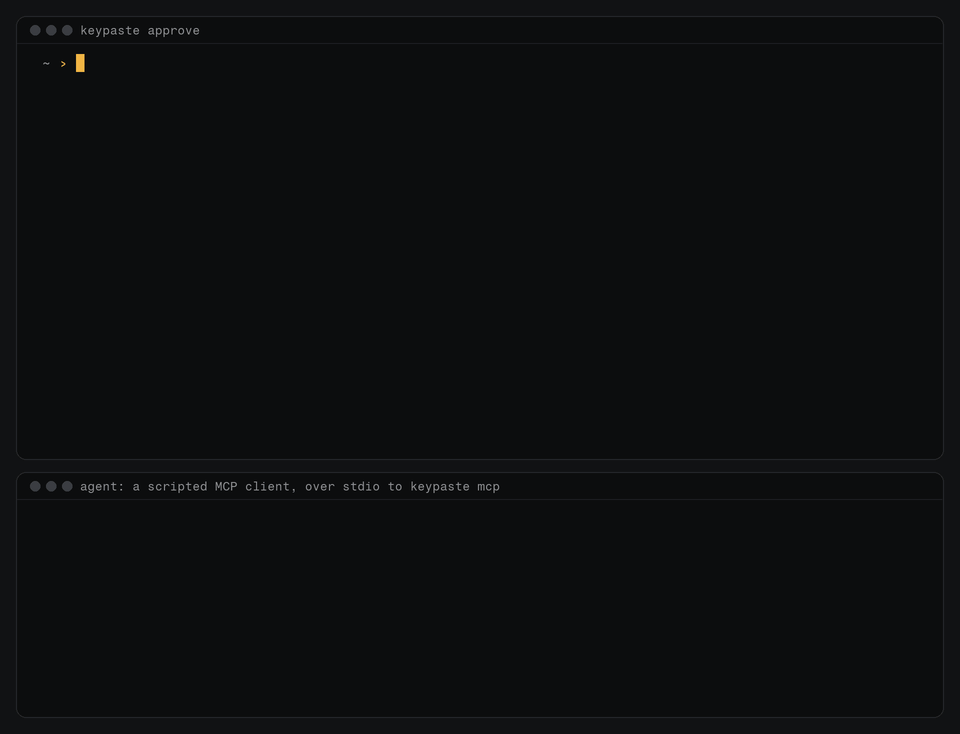
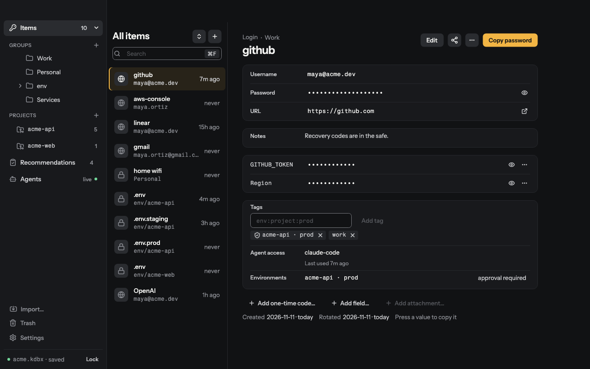
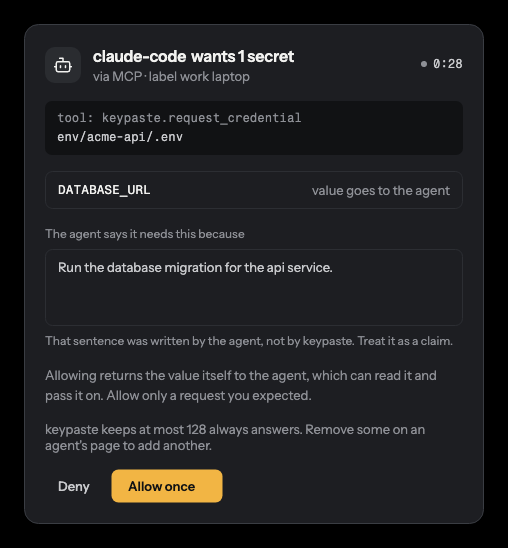
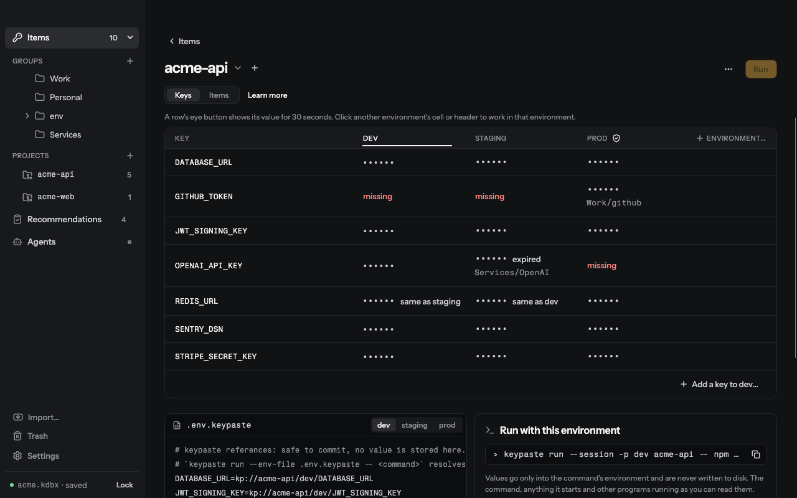
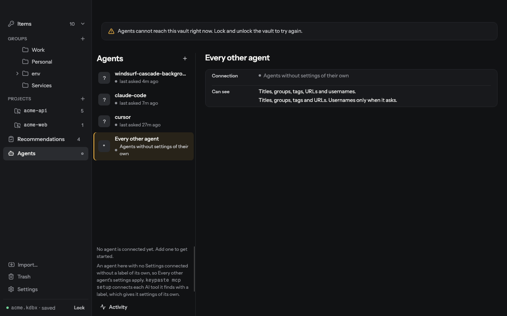

<h1 align="center">
  <picture>
    <source media="(prefers-color-scheme: dark)" srcset="assets/brand/keypaste-wordmark-dark.svg">
    <source media="(prefers-color-scheme: light)" srcset="assets/brand/keypaste-wordmark-light.svg">
    
  </picture>
</h1>

<p align="center">A local password manager whose AI agents get a secret only when you say yes.</p>

keypaste keeps your logins, keys and project values in a KeePass-format (KDBX) file on your computer, with no account, and KeePassXC opens the same file. It lets AI coding agents use what they need one field at a time, each use approved by you and logged. It has three parts: the `keypaste` command-line tool, the MCP bridge that connects AI tools such as Claude Code, and the desktop app.

## Where it stands

**You can install today:** the command-line tool and the MCP bridge, `v0.3.0`, for macOS (Apple Silicon), Linux (x64 and arm64) and Windows (x64). It stores items and project variables, runs a command with a project's variables in its environment instead of a `.env` file, and lets an agent ask for one field while you approve it in your terminal. [Install it](#install).

**1.0.0 adds** the desktop app for Windows, macOS and Linux, and it is the next public release (0.4.0 and 0.5.0 are never published). It is implemented in source and not yet published. It also brings a prompt with Always allow and Always block per agent, settings per kind of value (passwords, project variables, one-time codes and more), projects with dev, staging and prod environments, `.env.keypaste` reference files you can commit, key files and YubiKeys, Trash, imports from other password managers, share links, passphrases and browser fill through keypaste's own browser extension. [FEATURES](docs/FEATURES.md) gives each capability's state and version, and the guides below describe the 1.0.0 build.

**Planned later:** agents that use credentials they never hold, your own end-to-end-encrypted cloud vault, then team projects. None of these exists yet.

keypaste is open source under AGPL-3.0.

## Install

These blocks install `v0.3.0`. Download the archive and its checksum, verify the hash, then extract it. Each binary is a native executable with no .NET runtime dependency. The Unix instructions move both binaries into `~/.local/bin`.

<a id="macos--apple-silicon"></a>

### macOS: Apple Silicon

<!-- install:macos -->
```sh
curl -fLO https://dl.keypaste.com/v0.3.0/keypaste-0.3.0-osx-arm64.tar.gz
curl -fLO https://dl.keypaste.com/v0.3.0/keypaste-0.3.0-osx-arm64.tar.gz.sha256
shasum -a 256 -c keypaste-0.3.0-osx-arm64.tar.gz.sha256
tar -xzf keypaste-0.3.0-osx-arm64.tar.gz
mkdir -p ~/.local/bin && mv keypaste keypaste-mcp ~/.local/bin/
```
<!-- /install:macos -->

**macOS 14 or later.** This floor follows [.NET 10 support](https://github.com/dotnet/core/blob/main/release-notes/10.0/supported-os.md); no run backs this floor. Intel Macs have no published binary and need a source build.

<a id="linux--x64-and-arm64"></a>

### Linux: x64 and arm64

<!-- install:linux -->
```sh
curl -fLO https://dl.keypaste.com/v0.3.0/keypaste-0.3.0-linux-x64.tar.gz
curl -fLO https://dl.keypaste.com/v0.3.0/keypaste-0.3.0-linux-x64.tar.gz.sha256
sha256sum -c keypaste-0.3.0-linux-x64.tar.gz.sha256
tar -xzf keypaste-0.3.0-linux-x64.tar.gz
mkdir -p ~/.local/bin && mv keypaste keypaste-mcp ~/.local/bin/
```
<!-- /install:linux -->

For arm64, substitute `linux-arm64` in all three filenames. Both are built against glibc 2.35. The release workflow checks the x64 binary on a clean Debian 12 container and checks that it fails on Alpine; the equivalent container check is not implemented for arm64. Alpine and other musl distributions have no published binary; build from source there.

<a id="windows--x64"></a>

### Windows: x64

<!-- install:windows -->
```powershell
$a = "keypaste-0.3.0-win-x64.zip"
Invoke-WebRequest -OutFile $a "https://dl.keypaste.com/v0.3.0/$a"
Invoke-WebRequest -OutFile "$a.sha256" "https://dl.keypaste.com/v0.3.0/$a.sha256"
$want = (Get-Content "$a.sha256" -Raw).Split()[0]
if ((Get-FileHash $a -Algorithm SHA256).Hash -ne $want) { throw "checksum mismatch" }
Expand-Archive $a -DestinationPath .
```
<!-- /install:windows -->

Windows 10 1809 or later. This floor follows [.NET 10 support](https://github.com/dotnet/core/blob/main/release-notes/10.0/supported-os.md); no run backs this floor.

On Windows, put the extracted binaries in a directory on your `PATH`. On macOS and Linux, check that `~/.local/bin` is on `PATH` with `command -v keypaste`. Keep the absolute path of `keypaste-mcp` for your MCP client's configuration.

<a id="what-the-checksum-does-and-does-not-prove"></a>

### Download verification

The checksum detects a corrupted or incomplete download; it does not authenticate the publisher, because it is served from the same origin as the archive. The published binaries are unsigned and un-notarized. Every `v0.3.0` asset carries a build attestation that GitHub CLI can check without an account; [SECURITY.md](SECURITY.md#verifying-a-release) gives the steps and [THREATS.md](THREATS.md) T-21 the trust boundary. If macOS blocks the unsigned binary, `xattr -d com.apple.quarantine ~/.local/bin/keypaste` removes the quarantine attribute; the command-line download above should not set it.

If you still run `v0.1.0` or `v0.2.0`, replace it: [SECURITY.md](SECURITY.md) lists their defects, which `v0.3.0` fixes. Published versions never change, so the old downloads stay available with those defects.

## First steps

With `v0.3.0`:

```sh
keypaste init ~/vault.kdbx
export KEYPASTE_VAULT=~/vault.kdbx

keypaste add github --username me --url https://github.com
keypaste ls
keypaste get github            # copies the password, cleared after twenty seconds
keypaste get github --show     # prints it instead

keypaste env pull myapp        # imports ./.env into the project, then offers to delete it
keypaste run myapp -- npm start
```

`ls` prints a names-only group tree. Password prompts never echo, data goes to stdout and diagnostics to stderr, and `--vault` works in place of `KEYPASTE_VAULT`. `run` opens the vault, hands the project's variables to the command through its environment, closes the vault and writes nothing to disk. `env export --dotenv` writes plaintext when a tool needs a file. [Replace your `.env`](docs/replace-dotenv.md) covers projects, CI and export.

In 1.0.0, `get --reveal` replaces `get --show`, `rm` moves an item to Trash instead of deleting it, and a project's variables live on items tagged into the project; [FEATURES](docs/FEATURES.md#older-command-names-in-v030) lists every renamed command.

| exit code | meaning |
| --- | --- |
| 0 | success |
| 1 | usage error |
| 2 | internal or environment error (including no usable clipboard, and an item name two items answer to) |
| 3 | vault or item not found |
| 4 | wrong master password |
| 5 | the audit log is not the file keypaste wrote |

When stdin is not a terminal, each prompt reads one line in order: `init` takes the new password twice, and `add` and `env set` take the master password and then a value unless generating one.

### Generating one

`add` and `env set` generate the secret they store when you pass `--generate`, and print how strong it is rather than what it is:

```sh
keypaste add github --generate
keypaste add github --generate --length 32 --no-symbols --no-lookalikes
keypaste env set billing STRIPE_KEY --generate
```

Characters come from an 85-character alphabet that leaves out punctuation which breaks in a shell, YAML or a URL. Twenty characters is the default, about 128 bits; `--length` takes 8 to 256, `--no-symbols` keeps letters and digits and `--no-lookalikes` drops `Il1O0`.

1.0.0 adds passphrases from the [EFF long word list](third_party/eff-large-wordlist/UPSTREAM.md), about 12.9 bits a word: `--words` takes 6 to 32 and `--separator` sets what goes between them (a full stop by default; a hyphen is refused because four of the list's words contain one). `keypaste generate --words 6` prints a passphrase and stores nothing.

```sh
keypaste add github --generate --words 6
keypaste env set billing STRIPE_KEY --generate --words 8 --separator _
```

## Connecting an AI agent

In `v0.3.0`, your MCP client starts `keypaste-mcp`, which holds no vault and forwards each request. You start the approver, `keypaste agent`, in a terminal; it unlocks the vault and asks you about each request. `keypaste setup` registers the bridge with the AI tools it finds, or prints the configuration to paste. Client configuration holds no master password, and an agent cannot make keypaste ask for one.

```sh
keypaste agent --vault ~/vault.kdbx
keypaste setup --vault ~/vault.kdbx
```

In 1.0.0 the bridge is `keypaste mcp` inside the one `keypaste` binary, the terminal approver is `keypaste approve`, and the desktop app approves while it holds the vault unlocked. [Connecting keypaste to Claude](docs/mcp-setup.md) covers setup, manual configuration and what an agent can see.

## The approval



<sub>The 1.0.0 build's terminal approver, with a scripted MCP client in place of the agent. The published `v0.3.0` asks <code>Approve? [y/N]</code> instead. The prompt as text:</sub>

```
────────────────────────────────────────────────────────────
keypaste: an agent is asking for a credential.

  agent    claude-code (claude-code)
  item     env/demo/.env
  field    STRIPE_KEY

  the agent says it needs this because:
    deploy the billing service to staging

  That sentence was written by the agent, not by keypaste. Treat it as a claim.

[d] deny  [o] once  [a] always  [b] block  45s ›
```

Every request, allowed or refused, is one line in a local log, each line chained to the one before it, and `keypaste log` reads it back:

```
3 records in /home/you/.keypaste/audit.jsonl

  time (UTC)           agent        item           decision  method
  2026-07-26 14:03:09  claude-code  -              granted   exposure
  2026-07-26 14:03:11  claude-code  env/demo/.env  granted   prompt
  2026-07-26 14:07:44  claude-code  env/demo/.env  denied    prompt
```

[The demo](docs/demo.md) walks through a request, an approval and a deploy in about sixty seconds. [Approving an agent's request](docs/approvals.md) explains each choice and the log, and [SECURITY.md](SECURITY.md) what approval does not protect against.

## The desktop app

<p align="center">
  
</p>

<table>
  <tr>
    <td width="33%"></td>
    <td width="33%"></td>
    <td width="33%"></td>
  </tr>
  <tr>
    <td>An agent's request</td>
    <td>A project's keys</td>
    <td>Your agents</td>
  </tr>
</table>

The desktop app comes with 1.0.0. These screenshots are of the source build; [the desktop guide](docs/desktop.md) describes it.

## Guides

The guides describe the 1.0.0 build; each says what `v0.3.0` lacks.

- [Replace your `.env`](docs/replace-dotenv.md): projects, environments, `keypaste run`, CI and export.
- [Connecting keypaste to Claude](docs/mcp-setup.md): `keypaste setup`, manual configuration, key files and exposure.
- [Approving an agent's request](docs/approvals.md): the prompt, its choices and the audit log.
- [Agent settings](docs/policy.md): Ask, Allow or Block for each kind of value, per agent.
- [Running agents safely](docs/safe-agents.md): sandbox settings for Claude Code, Codex and Cursor.
- [The desktop app](docs/desktop.md).
- [The demo](docs/demo.md).
- [KeePass vaults and agent access](docs/keepass-and-agents.md): why approvals are local, and moving from another KeePass file.

[FEATURES](docs/FEATURES.md) lists every capability by surface and state, [RELEASE](docs/RELEASE.md) what is published and verified, [CHANGELOG](CHANGELOG.md) each change, and [SECURITY](SECURITY.md) and [THREATS](THREATS.md) the guarantees and limits.

## Building from source

Building from source lets you inspect the code you run, and it is the only route on Intel Macs, musl distributions such as Alpine, and Windows on ARM. With the .NET SDK pinned in [`global.json`](global.json):

```sh
git clone https://github.com/notinferred/keypaste
cd keypaste
dotnet build keypaste.slnx -c Release
```

`keypaste` lands in `artifacts/bin/Keypaste.Cli/release/` (`.exe` on Windows) and, built this way, is also the MCP bridge as `keypaste mcp`. The vault is KDBX 4 with AES-256 and Argon2d, written through [KeePassLib](third_party/KeePassLib/UPSTREAM.md) vendored from KeePass 2.61; keypaste writes no cryptography of its own. [CONTRIBUTING](CONTRIBUTING.md) covers verification and contributing, and [ARCHITECTURE](docs/ARCHITECTURE.md) the code map.

## Found something wrong?

Bugs, missing features and "this made no sense to me" go to the [issue tracker](https://github.com/notinferred/keypaste/issues). A report that says what you ran, what you expected and what happened is worth more than a polished one.

Report anything that looks like a security problem privately to <security@keypaste.com>, not the tracker. [SECURITY.md](SECURITY.md) owns scope, process and timing.

## License

[AGPL-3.0](LICENSE). Auditable code is how keypaste earns trust.
