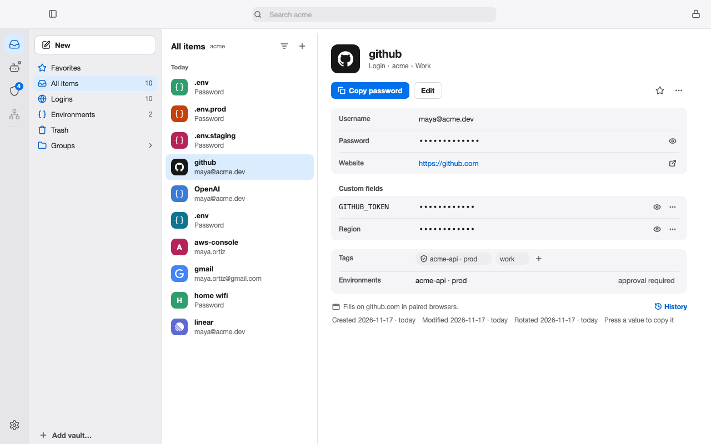
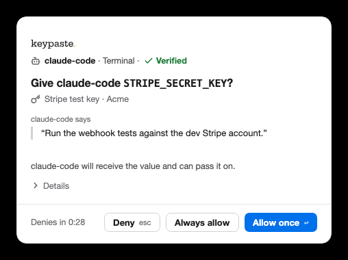

<h1 align="center">
  <picture>
    <source media="(prefers-color-scheme: dark)" srcset="assets/brand/keypaste-wordmark-dark.svg">
    <source media="(prefers-color-scheme: light)" srcset="assets/brand/keypaste-wordmark-light.svg">
    
  </picture>
</h1>

<p align="center">Your centralized access manager: passwords, keys and project environments on your computer, and AI agents get a secret only when you say yes.</p>

keypaste keeps your logins, API keys and project values in a KeePass (KDBX) file on your computer, with no account, and KeePassXC opens the same file. An AI tool such as Claude Code asks keypaste for one field at a time, nothing is released without your answer or a rule you set, and every request is logged. keypaste is the `keypaste` command-line tool, the MCP bridge that connects AI tools, and the desktop app.

## What it does

**Available now** in `v0.3.0`, the command-line tool and MCP bridge for macOS, Linux and Windows:

- **A vault you own.** An ordinary KDBX 4 file that opens with no account or network, and that KeePassXC reads and writes too.
- **Projects in place of `.env` files.** `keypaste run` hands a project's values to a command through its environment and writes nothing to disk.
- **One field per request.** An AI tool connected through the bridge asks for one field of one item, and you allow or deny it in your terminal.
- **A log you can check.** Every request, allowed or refused, is a line in a local hash-chained log that never holds the value.
- **Setup in one command.** `keypaste setup` connects Claude Code and Codex, and prints the configuration for Cursor and Claude Desktop.

**Coming in 1.0**, the next public release, which adds the desktop app for Windows, macOS and Linux. It is implemented and not yet published:

- **A prompt you read at a glance.** It names the agent asking and the item, quotes the agent's reason as a claim, and says Verified only when keypaste has checked which program is asking. You answer Deny, Allow once or, where keypaste allows it, Always allow.
- **Several vaults side by side.** Personal and work vaults stay open together, lock together, and each keeps its own agent rules.
- **One connection across vaults.** Each AI tool reaches only the vaults you chose when you connected it, through one keypaste connection.
- **Projects with stages.** Environments holds each project's dev, staging and prod values, Run starts a command with one stage's values, and `.env.keypaste` reference files can be committed.
- **Agent settings.** Ask, Allow or Block for each kind of value, for every agent or for one.
- **Browser fill.** keypaste's own extension pairs with the app by a matching code; click keypaste's key icon in a login field, pick a login by its title, and it fills.
- **Everyday vault care.** Item templates, one-time codes, Trash, history, a Security review of weak and reused passwords, key files, imports from other password managers and share links.

[FEATURES](docs/FEATURES.md) gives each capability's state. Planned after 1.0 and not built yet: agents that use credentials they never hold, your own end-to-end-encrypted cloud vault, team projects, then organizations with work vaults the company owns and hands over when someone leaves.

<table>
  <tr>
    <td width="68%"><picture><source media="(prefers-color-scheme: dark)" srcset="assets/screenshots/items-dark.png"></picture></td>
    <td width="32%"><picture><source media="(prefers-color-scheme: dark)" srcset="assets/screenshots/approval-dark.png"></picture></td>
  </tr>
</table>
<p align="center"><sub>1.0 preview: a vault's items, and an agent's request.</sub></p>

## Install

These blocks install `v0.3.0`, the command-line tool and the MCP bridge, from `https://dl.keypaste.com/v0.3.0/`. Each downloads the archive and its checksum, checks the hash, and extracts two native binaries, `keypaste` and `keypaste-mcp`, which need no .NET runtime. On macOS and Linux they go into `~/.local/bin`; `command -v keypaste` checks that it is on your `PATH`.

<details>
<summary><b>macOS</b>, Apple Silicon</summary>

<!-- install:macos -->
```sh
curl -fLO https://dl.keypaste.com/v0.3.0/keypaste-0.3.0-osx-arm64.tar.gz
curl -fLO https://dl.keypaste.com/v0.3.0/keypaste-0.3.0-osx-arm64.tar.gz.sha256
shasum -a 256 -c keypaste-0.3.0-osx-arm64.tar.gz.sha256
tar -xzf keypaste-0.3.0-osx-arm64.tar.gz
mkdir -p ~/.local/bin && mv keypaste keypaste-mcp ~/.local/bin/
```
<!-- /install:macos -->

**macOS 14 or later.** This floor follows [.NET 10 support](https://github.com/dotnet/core/blob/main/release-notes/10.0/supported-os.md); no run backs this floor. Intel Macs have no published binary and need a [source build](#building-from-source). If macOS blocks the unsigned binary, `xattr -d com.apple.quarantine ~/.local/bin/keypaste` removes the quarantine attribute; the command-line download above should not set it.

</details>

<details>
<summary><b>Linux</b>, x64 and arm64</summary>

<!-- install:linux -->
```sh
curl -fLO https://dl.keypaste.com/v0.3.0/keypaste-0.3.0-linux-x64.tar.gz
curl -fLO https://dl.keypaste.com/v0.3.0/keypaste-0.3.0-linux-x64.tar.gz.sha256
sha256sum -c keypaste-0.3.0-linux-x64.tar.gz.sha256
tar -xzf keypaste-0.3.0-linux-x64.tar.gz
mkdir -p ~/.local/bin && mv keypaste keypaste-mcp ~/.local/bin/
```
<!-- /install:linux -->

For arm64, substitute `linux-arm64` in all three filenames. Both are built against glibc 2.35. The release workflow checks the x64 binary on a clean Debian 12 container and checks that it fails on Alpine; the equivalent container check is not implemented for arm64. Alpine and other musl distributions have no published binary; build from source there.

</details>

<details>
<summary><b>Windows</b>, x64</summary>

<!-- install:windows -->
```powershell
$a = "keypaste-0.3.0-win-x64.zip"
Invoke-WebRequest -OutFile $a "https://dl.keypaste.com/v0.3.0/$a"
Invoke-WebRequest -OutFile "$a.sha256" "https://dl.keypaste.com/v0.3.0/$a.sha256"
$want = (Get-Content "$a.sha256" -Raw).Split()[0]
if ((Get-FileHash $a -Algorithm SHA256).Hash -ne $want) { throw "checksum mismatch" }
Expand-Archive $a -DestinationPath .
```
<!-- /install:windows -->

Windows 10 1809 or later. This floor follows [.NET 10 support](https://github.com/dotnet/core/blob/main/release-notes/10.0/supported-os.md); no run backs this floor. Put the extracted binaries in a directory on your `PATH`.

</details>

The checksum catches a corrupted or incomplete download; it cannot prove who published the archive, because it is served from the same origin. The binaries are unsigned and un-notarized, and every `v0.3.0` asset carries a build attestation that GitHub CLI checks without an account: [SECURITY](SECURITY.md#verifying-a-release) gives the steps and [THREATS](THREATS.md) T-21 the trust boundary. If you still run `v0.1.0` or `v0.2.0`, replace it; [SECURITY](SECURITY.md) lists their defects.

## Quick start

With `v0.3.0` installed:

```sh
# 1. Create a vault
keypaste init ~/vault.kdbx
export KEYPASTE_VAULT=~/vault.kdbx

# 2. Add a login, and a value to a project
keypaste add github --username me --url https://github.com
keypaste env set myapp STRIPE_KEY

# 3. Run a command with the project's values in its environment
keypaste run myapp -- npm start

# 4. Connect your AI tools, then answer their requests in this terminal
keypaste setup --vault ~/vault.kdbx
keypaste agent --vault ~/vault.kdbx
```

`keypaste get github` copies the password and clears the clipboard after twenty seconds, `--generate` on `add` or `env set` makes the value for you, and `keypaste env pull myapp` imports an existing `.env` into the project. The guides describe 1.0, which renames a few commands: `keypaste agent` becomes `keypaste approve`, the bridge becomes `keypaste mcp`, and `get --show` becomes `get --reveal` ([every rename](docs/FEATURES.md#older-command-names-in-v030)).

<details>
<summary>Exit codes and scripting</summary>

| exit code | meaning |
| --- | --- |
| 0 | success |
| 1 | usage error |
| 2 | internal or environment error (including no usable clipboard, and an item name two items answer to) |
| 3 | vault or item not found |
| 4 | wrong master password |
| 5 | the audit log is not the file keypaste wrote |

Data goes to stdout and diagnostics to stderr, and `--vault` works in place of `KEYPASTE_VAULT`. When stdin is not a terminal, each prompt reads one line in order: `init` takes the new password twice, and `add` and `env set` take the master password and then a value unless generating one.

</details>

## An agent's request

When an agent asks, the approver shows who is asking, for what and why, and waits for your answer. This is the 1.0 terminal prompt of `keypaste approve`; `v0.3.0`'s `keypaste agent` asks `Approve? [y/N]` instead.

```
────────────────────────────────────────────────────────────
keypaste: an agent is asking for a credential.

  agent    claude-code (claude-code)
  item     .env
  group    env/demo
  field    STRIPE_KEY

  the agent says it needs this because:
    deploy the billing service to staging

  That sentence was written by the agent, not by keypaste. Treat it as a claim.

[d] deny  [o] once  [a] always  45s ›
```

`keypaste log` reads every request back from the local log:

```
3 records in /home/you/.keypaste/audit.jsonl

  time (UTC)           agent        item           decision  method
  2026-07-26 14:03:09  claude-code  -              granted   exposure
  2026-07-26 14:03:11  claude-code  env/demo/.env  granted   prompt
  2026-07-26 14:07:44  claude-code  env/demo/.env  denied    prompt
```

## Learn more

The guides describe the 1.0 build, and each says what `v0.3.0` lacks.

- [The desktop app](docs/desktop.md): its places, vaults, prompts and current limits.
- [Replace your `.env`](docs/replace-dotenv.md): projects, stages, `keypaste run`, CI and export.
- [Connecting keypaste to Claude](docs/mcp-setup.md): `keypaste setup`, manual configuration and what an agent can see.
- [Approving an agent's request](docs/approvals.md): the prompt, its choices and the log.
- [Agent settings](docs/policy.md): Ask, Allow or Block for each kind of value, per agent.
- [Running agents safely](docs/safe-agents.md): sandbox settings for Claude Code, Codex and Cursor.
- [KeePass vaults and agent access](docs/keepass-and-agents.md): why approvals are local, and moving from another KeePass file.
- [The demo](docs/demo.md): a request, an approval and a deploy in about sixty seconds.
- [SECURITY](SECURITY.md) and [THREATS](THREATS.md): the guarantees, the threat model and the known limits.
- [FEATURES](docs/FEATURES.md), [RELEASE](docs/RELEASE.md) and [CHANGELOG](CHANGELOG.md): what each version has, what is published, and each change.
- [CONTRIBUTING](CONTRIBUTING.md) and [ARCHITECTURE](docs/ARCHITECTURE.md): building, testing and the code map.
- [keypaste.com](https://keypaste.com): how keypaste works, its products and the docs.

## Building from source

Building from source lets you inspect the code you run, and it is the only route on Intel Macs, musl distributions such as Alpine, and Windows on ARM. With the .NET SDK pinned in [`global.json`](global.json):

```sh
git clone https://github.com/notinferred/keypaste
cd keypaste
dotnet build keypaste.slnx -c Release
```

`keypaste` lands in `artifacts/bin/Keypaste.Cli/release/` (`.exe` on Windows) and, built this way, is also the bridge as `keypaste mcp`. The vault is KDBX 4 with AES-256 and Argon2d, written through [KeePassLib](third_party/KeePassLib/UPSTREAM.md) vendored from KeePass 2.61; keypaste writes no cryptography of its own.

## Found something wrong?

Bugs, missing features and anything that made no sense to you go to the [issue tracker](https://github.com/notinferred/keypaste/issues): say what you ran, what you expected and what happened. Report anything that looks like a security problem privately to <security@keypaste.com>, not the tracker; [SECURITY](SECURITY.md) owns scope, process and timing.

## License

[AGPL-3.0](LICENSE). Auditable code is how keypaste earns trust.
