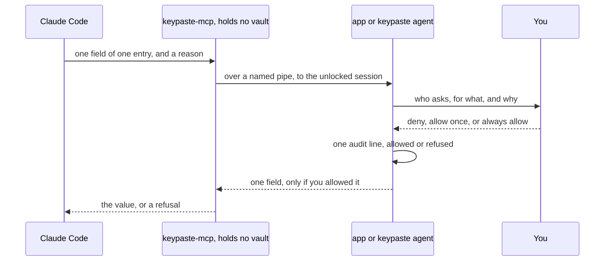
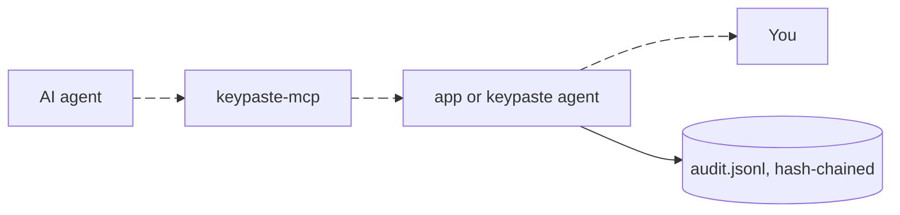

import Status from '../../../components/Status.astro';

<Status id="agent-approvals" />

An AI agent connected over MCP can see the entry names you expose and ask for one field of one entry, with a reason. You see which client is asking, for what and why, and you deny or allow it, and the release being built offers allow once. In the release being built you can also allow a kind of value, such as project variables, for every agent, after confirming that change: each such value is released without asking you, and still recorded. Every request lands in a local audit log, allowed or refused. Today the question appears in the terminal where `keypaste agent` runs; the desktop app asks in its own prompt window.

## How it works

The bridge your AI tool starts holds no vault and can never ask for your master password. The process holding the unlocked vault re-checks what the agent may see, reads the field only after your answer or a setting you confirmed, and writes the audit line before it replies. Locking the app, or stopping `keypaste agent`, refuses whatever is waiting and stops every release.

## What it does

- `keypaste setup` connects Claude Code and Codex and prints the configuration for Cursor and Claude Desktop; connecting every common AI tool in one step is being built.
- In the release being built, an agent sees each item's title, group, tags and URL, and its username unless you hide it. Each kind of value it asks for, passwords, custom fields, project variables, TOTP codes, notes and attachments, is asked about, allowed or blocked for every agent, as you set it in Settings, asked by default. Allowing a kind of value takes effect only once you confirm it, and a passkey is never released.
- Commands an agent asks to run are asked about every time, and only for an agent you let run commands.
- The rules are kept on your computer, sealed with a key your vault holds, so a synced vault or another program editing them gives an agent nothing more. The published `v0.3.0` instead reads standing rules you write in `policy.toml`.
- `keypaste log` shows the record, and `keypaste log verify` checks that nobody edited it.

## Limits

A value you release is the agent's from then on, and keypaste cannot revoke the credential at its issuer. The reason is the agent's own words, and the prompt says so. A release you allowed in advance has nobody reading it, and the rules are the same for every agent, so another program running as you that starts keypaste's bridge gets whatever you allowed. An agent that runs commands as you can reach things around the prompt, such as its own configuration; [the security model](/how-it-works/security/) lists them.

## Read more

- [Connecting keypaste to Claude](https://github.com/notinferred/keypaste/blob/main/docs/mcp-setup.md)
- [How to read an approval](https://github.com/notinferred/keypaste/blob/main/docs/approvals.md) and [agent settings](https://github.com/notinferred/keypaste/blob/main/docs/policy.md)
- [Agents without values](/products/agents-without-values/), the next step
