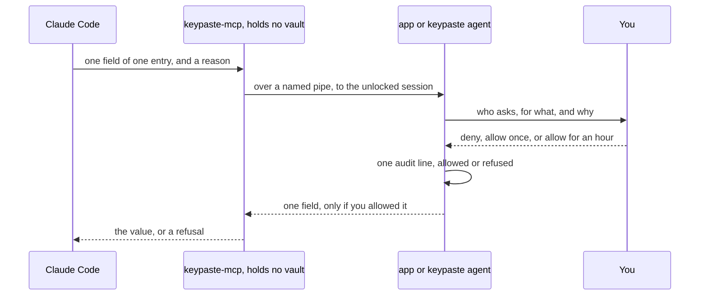
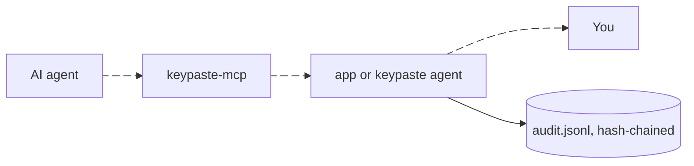

import Status from '../../../components/Status.astro';

<Status id="agent-approvals" />

An AI agent connected over MCP can see the entry names you expose and ask for one field of one entry, with a reason. You see which client is asking, for what and why, and you deny or allow it; an allowance lasts a limited time, and the release being built offers allow once or allow for an hour. In the release being built you can also set an agent to Automatic for a project you choose, after confirming that change: what it can see there is released without asking you, and still recorded. Every request lands in a local audit log, allowed or refused. Today the question appears in the terminal where `keypaste agent` runs; the desktop app asks in its own prompt window.

## How it works

The bridge your AI tool starts holds no vault and can never ask for your master password. The process holding the unlocked vault re-checks what the agent may see, reads the field only after your answer or a setting you confirmed, and writes the audit line before it replies. Locking the app, or stopping `keypaste agent`, refuses whatever is waiting and ends every allowance.

## What it does

- `keypaste setup` connects Claude Code and Codex and prints the configuration for Cursor and Claude Desktop; connecting every common AI tool in one step is being built.
- An agent sees your project variables by default. In the release being built, each agent has settings kept in your vault: what it can see, whether it is given values, whether it may run commands, and whether it is asked every time, asked with an hour on offer, or Automatic for a project or environment, optionally at most so many an hour or until a date. A change that gives an agent more waits for your confirmation; one that gives it less applies at once.
- Commands an agent asks to run, and anything in a production environment, are asked about every time.
- The settings are stored in the [Agent Credential Access Format](/acaf/v1/), which other KeePass apps can read and keep. The published `v0.3.0` instead reads standing rules you write in `policy.toml`.
- `keypaste log` shows the record, and `keypaste log verify` checks that nobody edited it.

## Limits

A value you release is the agent's from then on: an allowance's time limit ends its reuse, not the agent's copy, and keypaste cannot revoke the credential at its issuer. The reason is the agent's own words, and the prompt says so. An Automatic release has nobody reading it, and anyone who can open the vault, in KeePassXC for example, can change an agent's settings without keypaste asking. An agent that runs commands as you can reach things around the prompt, such as its own configuration; [the security model](/how-it-works/security/) lists them.

## Read more

- [Connecting keypaste to Claude](https://github.com/notinferred/keypaste/blob/main/docs/mcp-setup.md)
- [How to read an approval](https://github.com/notinferred/keypaste/blob/main/docs/approvals.md) and [agent settings and modes](https://github.com/notinferred/keypaste/blob/main/docs/policy.md)
- [The Agent Credential Access Format, version 1](/acaf/v1/)
- [Agents without values](/products/agents-without-values/), the next step
