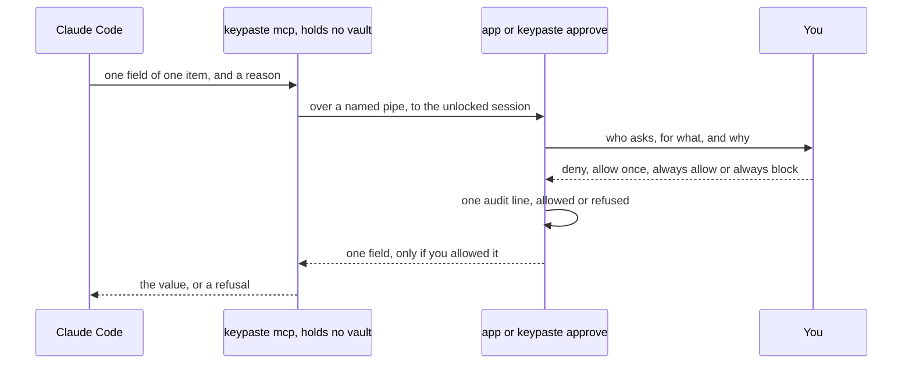
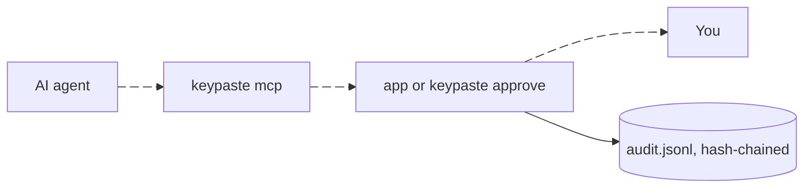

import Status from '../../../components/Status.astro';

<Status id="agent-approvals" />

An AI agent connected over MCP can see the items you expose and ask for one field of one item, with a reason. You see which agent is asking, for what and why, and you deny or allow it. Every request lands in a local audit log, allowed or refused.

The published `v0.3.0` asks in the terminal where `keypaste agent` runs, with `Approve? [y/N]`, and its bridge is the separate `keypaste-mcp` binary. Everything else on this page is implemented in the source for 1.0.0, the first desktop release, and not yet released: the desktop app's own prompt window, the terminal approver renamed `keypaste approve`, the bridge built in as `keypaste mcp`, and the choices Deny, Allow once, Always allow and Always block.

## How it works

The bridge your AI tool starts holds no vault and can never ask for your master password. The process holding the unlocked vault re-checks what the agent may see, reads the field only after your answer or a setting you confirmed, and writes the audit line before it replies. Locking the app, or stopping `keypaste approve`, refuses whatever is waiting and stops every release.

## What it does

- In `v0.3.0`, `keypaste setup` connects Claude Code and Codex and prints the configuration for Cursor and Claude Desktop. The 1.0.0 build also connects Gemini CLI, Devin, VS Code, Cursor and, on macOS and Windows, Claude Desktop itself, and the desktop app connects them from its Agents screen.
- In the 1.0.0 build, an agent sees each item's title, group, tags and URL, and its username unless you hide it. Each kind of value it asks for, passwords, custom fields, project variables, card values, identity values, TOTP codes, notes and attachments, is asked about, allowed or blocked for every agent, as you set it in Agents, asked by default. Allowing a kind of value takes effect only once you confirm it, and a passkey is never released.
- In the 1.0.0 build, commands an agent asks to run are asked about every time, and only for an agent you let run commands.
- In the 1.0.0 build, the rules are kept on your computer, in agent settings sealed with a key your vault holds, so a synced vault or another program editing them gives an agent nothing more. `v0.3.0` instead reads standing rules you write in `policy.toml`.
- `keypaste log` shows the record, and `keypaste log verify` checks that nobody edited it, in both versions.

## Limits

A value you release is the agent's from then on, and keypaste cannot revoke the credential at its issuer. The reason is the agent's own words, and the prompt says so. A release you allowed in advance has nobody reading it, and another program running as you that starts keypaste's bridge gets whatever you allowed for every agent, and under an agent's name what you allowed or always allowed for that agent. An agent that runs commands as you can reach things around the prompt, such as its own configuration; [the security model](/how-it-works/security/) lists them.

## Read more

- [Connecting keypaste to Claude](https://github.com/notinferred/keypaste/blob/main/docs/mcp-setup.md)
- [Approving an agent's request](https://github.com/notinferred/keypaste/blob/main/docs/approvals.md) and [agent settings](https://github.com/notinferred/keypaste/blob/main/docs/policy.md)
- [Agents without values](/products/agents-without-values/), the next step
