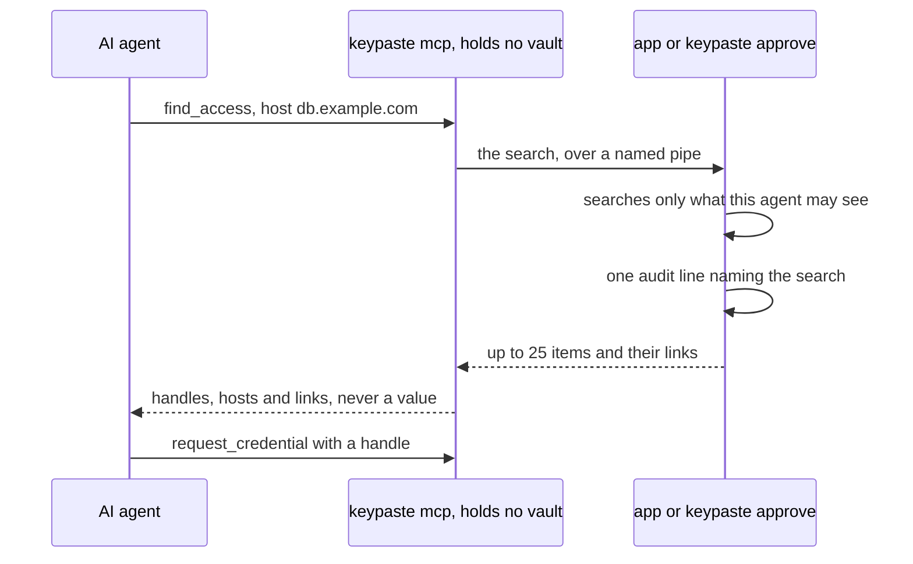

import Status from '../../../components/Status.astro';

<Status id="agent-search" />

An AI agent connected over MCP can search the items you expose instead of reading through all of them. It asks for a name, a host such as `db.example.com`, a kind such as server or API key, a project, or the items linked to one it already found, and gets back the best matches with what each is linked to. It never gets a value: it passes a match's handle to [agent approvals](/products/agent-approvals/), which asks you as before.

Everything on this page is implemented in the source for 1.0.0, the first desktop release, and not yet released. The published `v0.3.0` lists item names only.

## How it works

The app holding the unlocked vault runs the search and builds the links at the moment the agent asks, from what your vault already holds; nothing new is stored in your KeePass file. The bridge checks every item and both ends of every link against what it exposes before the agent sees them.

## What it does

- Finds items by text, host (matched by site, so `api.github.com` finds `github.com` items), kind, project, or the items linked to one the agent already has.
- Shows each item's handle, place, kind, host (scheme, host and port, never a path, query or password in the address), its username unless you hide usernames, its field names and projects.
- Links items on the same site, in the same project, or with the same username. With **Hosts and references** turned on in Agents, a search also shows the host in an item's Host field, and KeePass `{REF:…}` references link items too; it is off until you turn it on and confirm what every agent will then see.
- Lists the projects the matches belong to, with their stages and how many items each has.
- Returns at most 25 items with at most 8 links each, and records every search, with what was searched for, in the audit log.

## Limits

What a search shows reaches the agent's AI provider, as item names do today: an agent that may see everything can, by searching repeatedly, learn which hosts, usernames and projects your vault holds. Expose less to an agent that needs less. Item names can be written by someone else, in an imported file or a shared vault, so keypaste marks search results as untrusted data and the approval prompt shows the real item, never the agent's words about it; [the security model](/how-it-works/security/) lists the rest.

## Read more

- [Connecting keypaste to Claude](https://github.com/notinferred/keypaste/blob/main/docs/mcp-setup.md)
- [Agent settings](https://github.com/notinferred/keypaste/blob/main/docs/policy.md)
- [Agent approvals](/products/agent-approvals/)
