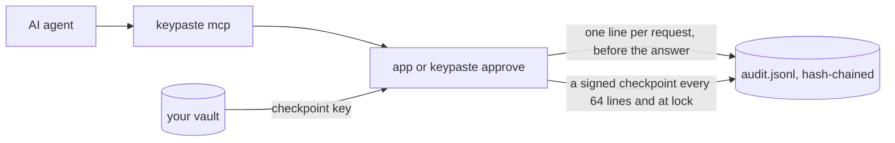

import Status from '../../../components/Status.astro';

<Status id="audit-log" />

Every request an AI agent makes, allowed or refused, is written to a log on your computer before keypaste answers it, and a release whose line cannot be written is refused. Each line carries the hash of the one before it, so an edited, removed or inserted line breaks the chain. keypaste never sends the log anywhere.

The published `v0.3.0` writes the hash-chained log and checks it with `keypaste log verify`. `--expect`, the signed checkpoints and the record of the calling program described below are implemented in the source for 1.0.0, the first desktop release, and not yet released.

## How it works

The app or `keypaste approve`, whichever holds your unlocked vault, writes each line, naming which agent asked, for which item and field, the reason it gave, and whether it was allowed. Every 64 lines, and when the vault locks, it adds a checkpoint signed with a key kept inside your vault, so rewriting the log and recomputing its hashes is detected by anyone who can open the vault.

## What it does

- Records every listing, search, release, save, run and token request the vault's owner answers, and refuses a release it cannot record.
- `keypaste log` shows the record; `keypaste log verify` checks the chain, and `--expect` checks it against a hash you kept.
- `keypaste log verify --checkpoints` opens your vault and checks each signed checkpoint, then says how many lines follow the last one.
- In the desktop app, Verify chain on the Activity page checks the signed checkpoints too while your vault is unlocked.
- Names the program that connected and, on Windows and macOS, whether its code signature checks out.

## Limits

The lines after the last checkpoint are not signed yet, and lines cut off the end of the log are detected only by `--expect` against a hash you kept. The program named is the one on keypaste's pipe, usually `keypaste mcp`, not the AI tool that started it, and another program running as you can pose as a signed one; keypaste records it and refuses nothing because of it. Someone who can open your vault can sign a rewritten log. [The security model](/how-it-works/security/) lists the rest.

## Read more

- [Approving an agent's request](https://github.com/notinferred/keypaste/blob/main/docs/approvals.md)
- [Agent approvals](/products/agent-approvals/)
