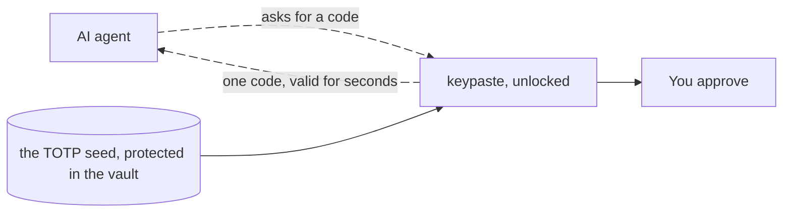

import Status from '../../../components/Status.astro';

<Status id="daily-driver" />

The first public desktop release, 1.0.0, is meant to make sure someone switching from KeePassXC loses nothing they use every day. None of this is in the published `v0.3.0` CLI. Its parts are at different stages:

- **Quick unlock with Windows Hello**, resuming a locked session while the master password stays the full unlock: implemented in the source for 1.0.0, not yet released. **Touch ID** is planned and needs the signed macOS app.
- **TOTP codes**, kept in the same protected `otp` field KeePassXC 2.8 reads: implemented in the source, not yet released.
- **Browser fill**, starting from the KeePassXC-Browser extension you may already have: pairing a browser with your vault is implemented in the source; filling a site's form is still being built.
- **Merging a synced file's changes**, so an edit from your phone and one from your desktop combine instead of one waiting for a reload: implemented in the source, not yet released.
- **Importers** from Bitwarden, LastPass, 1Password and KeePassXC CSV, previewed before anything is written: implemented in the source, not yet released.
- **Password health**: weak, reused and expired passwords listed in Recommendations, found on your machine with no network request: implemented in the source, not yet released.

## How a TOTP code reaches an agent

An agent can be given a code, never the seed that makes codes.

## Read more

- [Features](https://github.com/notinferred/keypaste/blob/main/docs/FEATURES.md) lists what each version has, and [the roadmap](https://github.com/notinferred/keypaste/blob/main/ROADMAP.md) owns the order of the remaining work.
- [KeePassXC and keypaste](/compare/keepassxc/)
