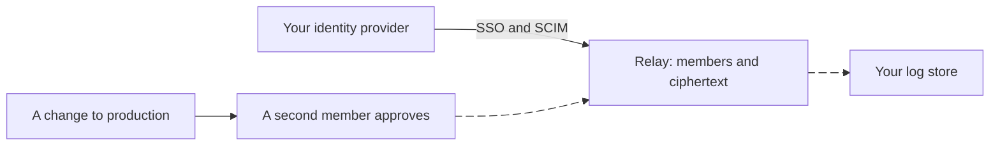

import Status from '../../../components/Status.astro';

<Status id="organizations" />

For organizations, keypaste adds what a security team asks for, with projects end to end unless the organization chooses server access for one. Work vaults belong to the company: one is created for each member and can be moved to another, and keypaste recommends moving every login and credential on the company's email domain into it. Members join through single sign-on and leave through SCIM provisioning; revoking a member's access hands their work vaults and credentials to the person the organization names, so nothing leaves with them and nothing is lost. A production change waits for a second member's approval. The relay's records export to the organization's log store, and the relay ships as a package to run on your own infrastructure.

## How it works

## Read more

- [Team projects](/products/team-projects/)
- [The vision](/vision/)
